  <picture><source media="(prefers-color-scheme: light)" srcset="assets/light/hero.svg"></picture>

  <picture><source media="(prefers-color-scheme: light)" srcset="https://github.com/wermisek/wermisek/raw/output/stats-light.svg"></picture>

  <picture><source media="(prefers-color-scheme: light)" srcset="assets/light/l-work.svg"></picture>

  <a href="https://gridtv.wermis.space"><picture><source media="(prefers-color-scheme: light)" srcset="assets/light/w1-gridtv.svg"></picture></a>

  <a href="https://szalonychampions.vercel.app"><picture><source media="(prefers-color-scheme: light)" srcset="assets/light/w2-championsy.svg"></picture></a>

  <a href="https://jtv.wermis.space"><picture><source media="(prefers-color-scheme: light)" srcset="assets/light/w3-jtv.svg"></picture></a>

  <a href="https://polecajkiszalony.wermis.space"><picture><source media="(prefers-color-scheme: light)" srcset="assets/light/w4-polecajki.svg"></picture></a>

  <a href="https://projektradiant.pl"><picture><source media="(prefers-color-scheme: light)" srcset="assets/light/w5-radiant.svg"></picture></a>

  Earlier: <a href="https://github.com/wermisek/Watchiru">Watchiru</a> · <a href="https://github.com/wermisek/HelpDeskFlutter">HelpDeskFlutter</a> · <a href="https://github.com/wermisek/StocksPredictor">StocksPredictor</a>. Source for most recent work is private — the live links are the best way to see it.

  <picture><source media="(prefers-color-scheme: light)" srcset="assets/light/l-stack.svg"></picture>

  <picture><source media="(prefers-color-scheme: light)" srcset="assets/light/stack.svg"></picture>

  <a href="https://www.twitch.tv/wermisek">Twitch</a> · <a href="https://instagram.com/wermisek">Instagram</a> · Discord <code>wermis</code>

